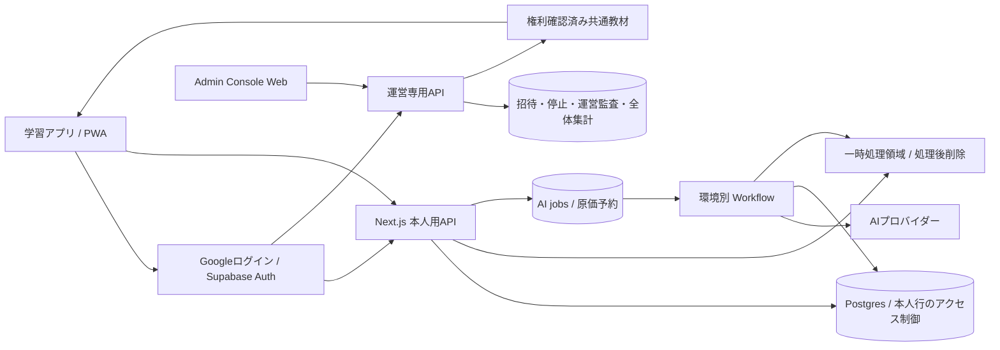
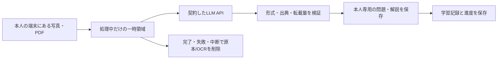

# ひび学習：多人数利用に向けたデータ・認証設計

更新: 2026-10-24 JST。状態: **推奨設計／DB・認証・Storageの移行は未実装**。現在の本番を切り替えた記録ではありません。対象は友人との招待テストから登録1,000人まで。登録人数だけで容量を保証せず、下記の同時利用負荷を測って段階的に拡大します。

## 1. 採用方針

**Next.js / Vercelを継続し、SupabaseのPostgres・Auth・非公開Storageへまとめる。ProductionとStagingは別プロジェクトにする。** 学習プラン、問題、回答記録、AIの処理状態をDBへ移し、Google Sheets / Driveは移行元として扱います。マイクロサービスや利用者ごとのDBは作りません。

- 全員が独立した学習者。利用者同士の監督・成績共有・代理ログインは設計に含めません。
- 運営権限は学習者属性と別の追加権限。Takashiもアプリでは自分の教材で学習します。
- 自分がアップロードした写真・PDFとOCR全文は作問中だけ扱い、処理後は保持しません。保存する派生問題・学習記録・必要最小限の会話は本人専用。原本の公開操作や共通教材への昇格経路を作りません。
- 運営が作成・権利確認した共通教材だけを、別のカタログとして配信します。
- 課金は未開始。会員状態とAI原価を記録できる構造を用意し、決済サービスの本番接続は別作業です。

Supabaseを勧める理由は、Postgresの整合性制約、Google認証、ファイルのアクセス制御を一つの運用先にまとめられるためです。これは設計判断です。単にサービスを選ぶだけでは安全にならず、API認可・DBの行単位制御・Storageのポリシーをそれぞれ実装します。[RLS](https://supabase.com/docs/guides/database/postgres/row-level-security)、[Storageのアクセス制御](https://supabase.com/docs/guides/storage/security/access-control)

| 比較案 | 判断 |
|---|---|
| Sheets / Driveのまま人数を増やす | 全履歴読取・共通割当・複数書込の整合性が障害になるため移行元として維持 |
| Supabase Postgres + Auth + Storage | 今回の推奨。運用先をまとめ、SQLと移行データをリポジトリで管理 |
| DB・認証・オブジェクト保存を各社から個別選択 | 将来の移行先候補。現段階ではID・認可・請求・障害調査の接続点を増やす利益が小さい |

## 2. 全体構成と信頼境界

上図をProductionとStagingにそれぞれ置きます。図のAdminDBは同じ環境のPostgres内でアクセス権を分けた領域です。運営権限に個人教材の読取権を付けません。DB/クラウドの保守権限者は技術的にデータへ到達し得るため、「運営も絶対に読めない暗号化」とは説明しません。通常Consoleからは到達不能とし、保守アクセスは理由・時間・対象を限定して監査します。

## 3. 現在の実装で先に解消する制約

調査対象はmain `4bc126c`と、学習者/Console分離の作業差分です。

| 現状の事実 | 影響 | 変更方針 |
|---|---|---|
| `src/server/google-store.ts`の`getFullState()`は全員のイベントを読み、その後本人分へ絞る | 人数・履歴とともに毎回の読取量が増加 | 最初から`owner_id`と必要期間・ページで問い合わせる |
| `src/lib/use-study.ts`は通常30秒、AI進行中5秒で状態を再取得 | 放置画面も保存用Googleアカウントの割当を消費 | 画面別取得、更新時再取得、AI jobのみ進捗確認、非表示時停止 |
| 保存用Googleアカウントをアプリ全体で共有 | 同時利用が増えるとSheetsの429が起きる | 回答保存をDBの短いトランザクションへ |
| 作問・相談の実行枠/日月制限が全体共通 | 1人の作問で他の利用者が待つ | 利用者別枠＋環境全体の同時実行/原価上限 |
| bootstrap登録が環境変数、招待・停止がイベント再生 | 利用者管理・検索・一意性の保証が複雑 | DBのアカウント/招待/認証主体テーブルへ |
| `workspaceId`は全員共通の保存環境ID | 学習プランや他人との共有境界には使えない | 個人データの主境界は`owner_id`。学習プランは個人内の分類 |

Sheets APIの標準割当は読取・書込それぞれユーザー/プロジェクト当たり60回/分、プロジェクト全体300回/分です。実際の割当は管理画面でも確認します。単純計算でも、30人が30秒ごとに1回読むだけで60回/分となり、実際には認証・学習操作の追加読取があります。登録者1,000人より先に**同時利用**が制約になります。[公式の割当](https://developers.google.com/workspace/sheets/api/limits)

## 4. DBの論理モデル

Postgresを正本とし、業務状態を毎回全イベントから再構成しません。回答・原価・運営操作は追記型の記録を残し、画面用の集計は更新可能な派生データとして再計算できる形にします。

| 領域 / 主なテーブル | 主な項目・制約 |
|---|---|
| `accounts` | 内部UUID、Authの`auth_user_id`（unique）、active/suspended/deleting、表示名、作成日時。表示名やメールを所有キーにしない |
| `legacy_identity_map` | 旧保存環境＋旧利用者ID→内部UUID。旧Google主体が確認できる場合はその対応も保持。移行専用・一般APIから非公開 |
| `operator_permissions` | account ID、許可する運営操作、有効/失効時刻。学習者が更新できるプロフィールとは別 |
| `invitations` | トークンのハッシュ、対象メール、期限、利用済みaccount ID、発行者。消費と登録を同一トランザクションで一度だけ |
| `learning_plans` / `plan_tags` | owner、タイトル、目標日、タグ、日々の量、更新version。「2学期中間テスト / 古文」は本人のプランと科目/タグ |
| `source_processing` / `source_receipts` | 処理中だけowner、一時キー、実MIME、サイズ、期限、parser/model/template version。処理後は削除完了日時・処理ID等の最小限のreceiptだけ。原本/OCR全文をDBに保持しない |
| `question_sets` / `question_versions` | owner、プラン、セット、問題本文・選択肢・出典、immutable version。正解・解説は権限を分けた取得経路 |
| `practice_sessions` / `session_items` | owner、出題時の問題version・順序。既存session snapshotの意味を維持 |
| `attempts` / `question_progress` | owner、session item、選択、サーバー採点結果、日時。回答は追記、進度は派生。最初の回答は一意制約で固定 |
| `planning_turns` / `generation_jobs` | owner、プラン、会話、source/version、template version、状態、lease、試行番号、取消状態、結果参照 |
| `ai_usage` / `usage_reservations` | owner、job/step、request ID、model、価格表version、token数、原価、通貨、予約/確定/結果不明。浮動小数の料金計算を避ける |
| `entitlements` / `billing_events` | 将来の利用資格・決済event ID。本人の利用可能量と決済情報を分離。現状は課金未開始 |
| `feedback` / `push_subscriptions` | 送信者・本人購読。feedbackのみ本人が送信した内容をConsoleで扱う |
| `operator_audit` / `migration_runs` | 誰が何を変更したか、取込manifest・件数・checksum・完了位置。原本本文や秘密値は監査ログに入れない |
| `catalog_*` | 運営が用意した共通教材と版・権利確認。私有教材からコピーする公開APIを持たない |

すべての私有データは`owner_id NOT NULL`。既存の任意ownerやaudienceをそのまま新スキーマへ持ち込まず、判定できない記録は隔離します。セット・原本・問題・sessionの参照は`(owner_id, referenced_id)`の複合外部キーで同じ所有者に限定します。共通教材は別の参照型を使い、`owner_id NULL`で無制限に共有する方式にしません。

主な索引は`(owner_id, updated_at, id)`、`(owner_id, plan_id, status)`、`(owner_id, answered_at, id)`、`(owner_id, question_id, question_version)`、待機jobの`(status, available_at)`。一覧はcursor方式で20〜50件、回答履歴も期間/ページを必須にします。1,000人で即パーティションや読取レプリカを導入せず、実測したquery planとテーブル量で判断します。

## 5. 認証・本人限定・運営権限

### ログインとセッション

- Supabase AuthのGoogle OAuth / PKCEを使用。Googleの`issuer + sub`を認証主体とし、メールは連絡・招待照合用。未確認メールや入力値で他人の記録を結び付けない。
- サーバーは署名・issuer・audience・期限を検証し、DBのactive状態を各保護操作で確認する。cookie内のユーザー情報を読むだけでは認証済みと扱わない。
- SSRの公式更新フローでセッションを維持。学習者は30日を目安に再ログイン負担を抑え、停止/削除はDBの状態判定で新しい保護操作を即時拒否する設計。明示ログアウトは端末の認証情報削除とrefresh token失効。発行済みaccess tokenには短い残存期間があるため、即時失効が必要な運営操作はsession失効も確認する。更新tokenと同じ有効期限をaccess tokenに与えない。
- 運営操作はMFAと直近の確認を要求する設計。学習アプリの普段の利用に運営MFAを毎回要求しない。
- 本人用のHTML/APIと`Set-Cookie`応答は共有CDN・ISR・Service Workerに保存しない。ログアウト時は本人データの端末cacheも消す。tokenをログ/URL/フィードバックに含めない。

SSRは公式のNext.js連携に沿い、検証と更新を共通化します。失効の即時判定には署名検証だけでなくaccount状態の確認も必要です。[Next.js / SSR](https://supabase.com/docs/guides/auth/server-side/creating-a-client?queryGroups=framework&framework=nextjs)、[セッション](https://supabase.com/docs/guides/auth/sessions)、[ログアウト後のtoken](https://supabase.com/docs/guides/auth/signout)

### DBとAPIの両方で認可する

通常APIは、検証した利用者JWTでDBへアクセスします。RLSは`auth.uid()`に対応するactive accountを求め、本人の行だけ許可します。INSERTの`WITH CHECK`、UPDATEの旧行/新行、DELETEにも同じ制約をかけ、owner変更を許しません。アカウント解決helperが必要なら、固定`search_path`・最小権限・固定SQLで監査し、クライアント指定のaccount IDを信頼しません。

**現行NextAuth cookieはSupabaseの`auth.uid()`にはなりません。** Authと本人用DBアクセスをStagingで一緒に実装し、移行前の本番は現行経路を保ちます。通常APIを`service_role`で動かして「RLSで保護した」と扱わないこと。service keyはRLSを回避するため、一般利用API/Consoleには配備せず、移行など限定された保守用途に閉じます。

直接のtable grantも絞ります。回答結果、運営権限、AI原価、共通教材、正解付きsession snapshotはクライアントから任意更新できません。採点は専用RPCでsessionの所有者と固定versionを確認し、回答保存＋進度更新を同一トランザクションで行います。正解表示タイミングはAPIの出題/回答DTOで制御し、広いSELECT権限で迂回できないようにします。

| 操作 | 本人 | 別の利用者 | 運営権限で追加される範囲 |
|---|---|---|---|
| 私有原本・抽出文・問題・AI会話・履歴 | 可 | 不可 | 追加なし |
| 本人プランの編集・作問 | 可 | 不可 | 追加なし |
| 共通教材を学ぶ | active会員 | active会員 | 教材の作成・更新・公開 |
| 招待・利用停止 | 自分では不可 | 不可 | 可、操作監査あり |
| feedback | 自分の送信内容 | 不可 | 送信された内容のみ確認 |
| AI利用 | 本人の残量・履歴 | 不可 | 全体の費用/失敗率集計。個人の問題本文や成績は含めない |

Consoleのボタン表示だけでなく、ページ、API、DBの各境界で判定します。失効した運営権限を古いJWTのclaimだけで維持しません。集計は専用の限定RPC/表を使い、少人数の内訳から成績が分かる切り口を作りません。

## 6. 原本を保持しない作問フロー

**最新ユーザー方針: 個人の写真・PDFはLLM処理のためだけに受け取り、運営の教材保管庫を作らない。** これは新設計です。現行アプリはDriveに原本とSheetsに解析結果を保存しているので、まだ「処理後削除」を利用者に表示してはいけません。

- できるものはメモリ/streamで処理。サイズや非同期処理のため一時objectが必要な場合は、専用private bucketへ暗号化保存し、通常教材用Storageとは分ける。
- 一時キーは`account_uuid/job_uuid/object_uuid`。メール・氏名・原本名をURLへ入れない。本人認証と容量予約後に、指定キーだけへのupload許可を発行する。任意パス・上書き・public URLは不可。標準の署名upload URLは2時間有効で削除後にも再送され得るため、一時原本には使わない。upload開始/完了の両方でactiveなjob・期限・指定キーをproxyまたはRLSで確認し、完了済み/中断済みjobの遅延uploadを拒否して残存objectを回収する。[署名uploadの仕様](https://supabase.com/docs/reference/javascript/file-buckets-createsigneduploadurl)
- 実サイズ、MIME/マジックバイト、件数、PDFページ数、処理時間を制限。隔離状態から検査済みのものだけLLMに渡す。壊れたPDFや超過入力は処理しない。
- 原本とOCR全文は処理に必要な間だけ。LLM受理後に不要になった原本は早期削除し、完了・失敗・中断時には必ず削除を要求。取り残しは期限ジョブで回収する。**最大1時間は初期の保持上限案**であり、処理timeoutもこれ以下に固定し、実装/監視/削除試験後に利用者へ提示する。
- 削除が失敗したら`deletion_pending`を記録し再試行、上限接近で警告。削除済みと表示するのは実体消去を確認してから。実ファイルやOCRを削除台帳へコピーしない。
- 原本、OCR全文、画像base64、入力promptの全文をDB、ログ、APM、session replay、CDN、バックアップへ保存しない。**Workflowの引数・step戻り値も永続化され得るため、raw bytesや抽出全文を渡さず、一時object IDのみ扱う。** workerの例外・クラッシュdumpも本文を収集しない。
- AIが返した問題・解説にも原文の大量転載を含めない。source noteは範囲/ページ等の最小限とし、原文画像・全文復元・長い引用を問題に添付しない。ユーザーが教材本文をチャットに貼った場合も同じ一時処理経路にし、会話履歴へ原文を残す抜け道を作らない。
- 消去後の原本プレビューやOCR修正、原本を使った後日の追加作問は提供しない。必要なら本人が再アップロードする。既存の問題からの派生は保存済み問題だけで作り、元の教材を確認したとは説明しない。
- OCRキャッシュは一つのjobの保持期限内だけ。利用者をまたぐキャッシュ、原文検索/RAG、私有原本のdedupは行わない。承認済み共通教材は別カタログで継続保存できる。
- LLMへはそのjobの本人データだけ渡す。教材中の命令をシステム命令にせず、外部URL取得/他人source選択を許さない。APIキーはサーバーに置き、非保持のためにブラウザへキーを渡さない。
- LLM側の保存はアプリ側と別。採用API・モデル・機能ごとの保持期間/学習利用/削除方法を確認する。Files API、batch、prompt cache等の保存機能を無条件で使わず、永続化があるなら使用しないか、保持方針に合う削除を実装する。「学習に使わない」は「保存しない」ではない。

現行Claude APIの標準方針では入出力の保持があり、アプリ内の削除だけで提供元の即時削除は保証できません。Zero Data Retentionも契約・モデル・機能の適用範囲を確認します。[Anthropicの保持方針](https://privacy.anthropic.com/en/articles/7996866-how-long-do-you-store-my-organization-s-data)、[API別の保持条件](https://platform.claude.com/docs/en/manage-claude/api-and-data-retention)

原本を保持しないことは著作権リスクを減らす設計で、適法性の保証ではありません。利用者には権利・適法な利用根拠のある教材だけを入力すること、本人利用限定であることを求めます。API契約上の顧客である運営にも責任が残るため、「利用者が責任を負う」文言だけで完了としません。原文の転載抑制、非共有、申告対応を合わせて実装します。[文化庁の整理](https://www.bunka.go.jp/seisaku/bunka_gyosei/kibankyoka/faq/index.html)、[OpenAI API規約 §4.3](https://openai.com/policies/services-agreement/)、[Anthropic商用規約](https://www.anthropic.com/legal/commercial-terms)

保存する問題・学習記録・共通教材には復旧用バックアップを用意します。一時原本/OCRはバックアップ対象外にします。DBバックアップにStorage実体が含まれないので、継続保存する共通教材ファイルは別途復元検証します。[バックアップ範囲](https://supabase.com/docs/guides/platform/backups)

## 7. AI job・原価・同時実行

小規模の初期値は**利用者あたり実行中1件**、環境全体は少数の同時実行枠から始めます。2〜4並列は負荷試験用の候補で、プロバイダー枠と実際の処理時間から確定します。待機は利用者ごとに順番を回し、一人の大量依頼が全枠を占めないようにします。

1. 本人のsource/plan/versionと利用資格を確認。`owner + idempotency_key`をuniqueにし、同じ操作は同じjobを返す。
2. DBトランザクションで利用者の残枠、全体の原価予算、予約額を確保し、jobとoutboxを作る。残枠のread→writeを別処理にしない。予約額は入力上限・最大出力（思考分を含む）・価格段階・最大有料呼出し数から保守的に算出。次stepの予約が不足する場合は原子的に追加予約できなければ止める。結果不明の予約は期限だけで利用可能枠へ戻さず照合する。
3. Workflowはjob IDから固定された所有者/対象を読み、leaseとfencing tokenを取得。再開時にも停止状態・環境・所有者を再確認。
4. 外部APIのrequest ID、provider idempotency対応、step結果を記録。timeoutで結果が不明なら`unknown`にし、予約を保留。無条件の有料再送をしない。自動再実行しても外部APIを厳密に一度だけ呼べるとは保証しない。
5. 同一stepの保存は一意制約で一度だけ。実原価を確定し予約差額を解放。古いworkerはfencing token不一致で業務結果を確定できない。ただし送信済みAPIのreceipt/usageはrequest IDで重複なく追記でき、現workerまたは照合処理が原価を確定する。lease喪失を理由に実課金の記録を捨てない。
6. workerは本人データ全件の読取鍵を使わず、claim済みjobと紐付くsource/resultsだけを操作する限定RPCを使う。Storageアクセスもそのjobのファイルだけ短命に許可する。API利用者が任意ownerとしてworkerを起動できない。

古文単語テンプレートは`template_id + template_version`をjobに保存。OCR・作問・検証を別stepにし、同じjobの保持期限内だけ原文を再利用します。期限切れ後の再開には原本の再アップロードを求め、有料処理の結果不明と原本削除状態を別々に管理します。日/月の利用者制限、アプリ全体の上限、AIプロバイダーの警告を重ねます。モデル変更時は価格表versionを保存し、過去の原価を最新単価で書き換えません。

料金案は月1,000円＋追加AI原価×1.3、課金開始は保留。30%上乗せは追加分の粗利率約23.08%で、全体50%目標とは別です。1,000人の基本売上100万円、追加AI原価C、その他ランニング費Fとすると、目標条件は`F <= 500,000 - 0.35C`（同じ税・通貨基準、手数料・為替費用をFへ含める）。料金を固定しただけでは利益率は保証されないため、含有AI枠は実測して設定します。SupabaseのSpend Capもすべての費用を制限するものではありません。[費用制御](https://supabase.com/docs/guides/platform/cost-control)

## 8. Production / Staging

既存の[STAGING_PLAN.md](STAGING_PLAN.md)を上書きして無効化せず、次の移行先を追加します。

| 対象 | Production | Staging |
|---|---|---|
| Vercel | 既存study-app、本番URLを維持 | study-app-staging、固定の別URL |
| Supabase | hibi-production候補 | hibi-staging候補、DB/Auth/Storageすべて別 |
| Google OAuth | 本番用callbackとclient | 専用client、専用callback、検証アカウント |
| データ | 本人の実データ | 合成データと権利確認済み教材だけ |
| AI / 音声 / 通知 | 運用上限、各用途別停止スイッチ | 既定OFF、実試験は専用key・少額上限・検証宛先 |
| job / cron / webhook | 本番署名と実行先 | 別署名・別run namespace。相互受信拒否 |
| PWA | ひび学習 | ひび学習 TEST、常時表示・別アイコン・別origin |
| Preview / ローカル | 本番secretを渡さない | 合成fixtureまたは専用ローカルDB。公開Previewは外部処理OFF |

`APP_ENV`、Vercel project ID、Supabase project ref、許可origin、Storage/DBの環境markerを対応させ、起動時と有料job開始時に検証します。DBにはデプロイから書き換えられない環境markerを置き、設定同士が自己一致しているだけで通さない。未知/欠落/交差設定はfail closed。`VERCEL_ENV=production`だけでは二つのVercelプロジェクトを区別できません。

短期にSheets版のStagingを先に作る場合も、別Sheet/Drive/OAuth/保存用接続で作ります。ただし**その分離だけで1,000人対応とはしません**。新規利用者拡大の前にSupabase版のStagingで下記の試験を完了します。

## 9. 移行・公開・切り戻し

| 段階 | 作業 | 終了条件 |
|---|---|---|
| A 現行整理 | 学習者モデルと運営権限を分離。旧ID/保存値は互換adapterへ | 既存テスト・本人隔離・Console認可が通る |
| B 検証基盤 | StagingにDB/Auth/Storage、schema migration、RLS、環境guard、停止スイッチを構築 | 二人＋運営＋停止アカウントで境界試験。外部本番へ一切書かない |
| C 経路移行 | Store interfaceを小さく切り、招待・本人取得・回答・原本・jobの順に実装。Authも同じStagingで接続 | API契約と固定問題version/重複回答の意味を維持 |
| D 移行リハーサル | 本番snapshotを本番用隔離移行領域へ取込。Stagingへ私有データをコピーしない | owner別件数、問題/回答version、未解決job、原本を新基盤へ持ち込まないことを照合 |
| E 切替 | 短い書込停止、worker停止/結果不明の照合、最終差分を一度取込、検証済み版へ | 本人データ整合を確認して新DB書込を開放 |
| F 招待拡大 | 友人10人程度→50人→負荷試験→段階拡大 | エラー率・待ち時間・原価・退会・復元を確認 |

移行には`source environment + event ID`のuniqueキーとmanifestを付け、再実行で重複を作りません。既存のuser/topic/question/session ID、問題version、回答日時、初回答を保ちます。新内部UUIDへ変換しても旧IDをmappingに残します。所有者不明の記録や過去の配信状態は推測で他人に割り当てず隔離し、本人が今見えている範囲を照合します。既存の個人原本/OCR全文は新基盤に移しません。破壊的な削除に入る前に対象manifestを作り、保持方針変更の案内と必要な確認を経て旧Drive/Sheet/バックアップからの消去まで追跡します。この設計作成時点では既存ファイルを削除していません。

Auth移行時は旧セッションで検証したGoogle主体と新Authの主体を、一回限りのサーバー側引継ぎで一致確認します。既存主体を証明できない場合は保留して本人確認します。メール入力だけで過去データを引き継がせません。認証基盤の変更時に一度だけ再ログインが必要になり得る点は、移行時に明示します。普段の長期ログイン維持の不具合とは分けて検証します。

切り戻しは時点で分けます。**新DBへの書込を開く前**なら旧版＋旧保存先へ戻せます。**書込開始後**は旧Sheetsへ自動で戻しません。新DB互換の旧アプリへ戻すか、再び書込停止し新規記録を照合してから移行し直します。Vercel rollbackだけでデータは戻りません。旧Sheets/Driveは移行検証の間read-onlyにし、原本/OCRの消去完了までは新しい非保持方針への移行完了としません。問題・学習記録の復旧用データは原本から切り離し、保持期限と復元確認後に旧保存先を廃止します。恒久的な二重書込は採用しません。

## 10. 拡大前に通す試験と運用指標

- **利用者隔離**: AのtokenでBのIDを指定した一覧/詳細/更新/削除/原本/音声/jobを拒否。operatorにも例外を作らない。RLSとAPIを別々に試験し、成功時の本人行も検証する。
- **認証**: 招待期限、二重使用、メール違い、停止済み/期限切れ/偽token、ログアウト後、運営失効、二端末セッションを確認。iPhone PWAで再開・翌日・長期ログインを実機確認。
- **整合性**: 二端末で同じ回答、同時job開始、queue再配信、worker落ち、timeout後再開、原価二重計上、利用上限の並行突破を試験する。
- **ファイル**: 他人path、署名期限、拡張子偽装、過大容量、壊れたPDF、未完了upload、処理後の削除、取り残し回収、Workflow履歴/ログ/backupに本文が残らないこと、退会後のアクセスを確認。
- **環境混入**: Stagingへ本番project ref/Storage ID/署名を渡したとき起動・job・書込が拒否される。Previewから有料処理を開始できない。
- **負荷（提案目標）**: 1,000登録・100同時利用、各10秒に1回答で10回答/秒、30分継続。50〜500万回答規模の合成履歴でも全件走査しない。さらに短時間3倍負荷で過負荷時に壊れず待機/429となる。API p95 <500ms、エラー率<1%、回答欠落/重複0を目標とし、実測前に達成済みとは表記しない。
- **復旧（招待テスト段階の提案）**: 毎日バックアップ、RPO24時間以内/RTO4時間以内を復元演習で確認。課金開始前はRPO1時間以内を目標にPITR等の追加費用を評価。継続保存する共通教材Storageも同じ復旧目標を満たすコピー方式を選ぶ。一時原本は復元しない。

監視対象は認証失敗、本人API p95/5xx/429、DB接続/CPU/遅いquery、Storage容量/egress、job待ち時間/失敗/結果不明、予約原価/実原価、復元日です。アラートとログに教材本文、Google token、署名URL、利用者の成績を含めません。serverlessの直接DB接続を使う箇所は接続poolを制限し、transaction poolerとの互換を確認します。[接続方式](https://supabase.com/docs/guides/database/connecting-to-postgres)

## 11. 実装担当への最初の単位

最初のPRはStaging用schema/RLSと二人の境界テスト、Auth接続、本人アカウントの取得まで。次に本人の問題一覧→回答保存→原本upload→AI jobと進めます。各PRで本番は現行Storeを維持し、Stagingの合成データで検証します。Consoleには環境名・版・障害集計を追加しますが、DB管理ツールや任意SQL実行画面は埋め込みません。

有料プラン/リージョン/外部アカウントの実作成は、採用時の料金と既存契約を確認して設定します。この文書作成では契約・本番データ移動・課金開始を行っていません。教材担当の生成・音声台帳には触れず、[CONTENT_HANDOFF.md](CONTENT_HANDOFF.md)に従って承認済み成果物だけを受け取ります。
